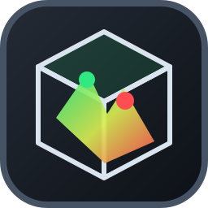

<p align="center">
  <a href="README.md">中文</a> |
  <a href="README.en.md">English</a>
</p>

<div align="center">
  

  # Tron 3D viewer

  **A lightweight, open-source 3D microscopy image viewer**

  Open IMS and TIFF volumes, interactively adjust channels and viewing angles, and export images for scientific publications.

  [](https://www.python.org/)
  [](https://www.qt.io/qt-for-python)
  [](https://www.opengl.org/)
</div>

## Features

- **3D volume rendering**: View IMS and multipage TIFF images using maximum intensity projection (MIP), with multichannel overlays.
- **Interactive views**: Rotate, pan, and zoom freely. Switch to XY, XZ, or YZ orthogonal views with one click, or set precise rotation angles.
- **Channel controls**: Independently adjust each channel's color, visibility, contrast, gamma, and opacity, with one-click automatic adjustment.
- **Spatial calibration**: Read voxel sizes from image metadata, or recalibrate using voxel sizes or overall physical dimensions.
- **Save and restore IMS**: Keep image data, voxel calibration, view, channel settings, Frame visibility, and tick spacing together and restore them when reopened in Tron 3D viewer.
- **Customizable axes**: Show or hide the frame, grid, ticks, and labels independently, remember your last choices, and customize tick spacing along X, Y, and Z. The grid is hidden by default.
- **High-quality exports**: Export PNG images at 1×, 2×, or 4× resolution, or PDFs with vector ticks and text for publication layouts.
- **Large-image previews**: Automatically downsample according to data size and adapt rendering quality during interaction to balance responsiveness and still-image quality.
- **Simple desktop interface**: A dark PySide6 interface displays image dimensions, channel count, voxel sizes, and physical dimensions in real time.

## Interface and Export Examples

These examples use the retina dataset with CollagenIV (red) and GFAP (green) channels overlaid.

**Application interface**: Select channels and adjust their display parameters in the Channels & Display panel.


**PNG export**: The exported image retains the black background, 3D frame, and axes.


**PDF export**: This preview is rendered from an actual PDF export. The area outside the frame is transparent and appears white on the page; the frame, grid, ticks, and text remain vector elements in the original PDF.


## Installation

Go to [Releases](https://github.com/Achuan-2/tron3dviewer/releases/latest) and download the installer for your system:

- **Windows**: Download and run the `.exe` installer.
- **macOS**: Download the `.dmg` installer, open it, and drag the app into Applications.

The installers include the runtime environment, so you do not need to install Python separately.

## Usage

Launch the app, then open an IMS or TIFF image.

### View and adjust images

The interface currently uses Chinese labels; the relevant labels are included below for reference.

1. Drag an IMS / TIFF file into the window, click **Open 3D IMS / TIFF (打开三维 IMS / TIFF)**, or press `Ctrl+O` to select an image.
2. Select a channel in the **Channels & Display (通道与显示)** panel on the left and adjust its color, Min/Max, gamma, and opacity.
3. Use the **Spatial Calibration (空间校准)** and **Frame · Axes (Frame · 坐标轴)** panels to set physical dimensions, axis elements, and tick spacing.
4. Adjust the composition with the mouse or the **View and Rotation (视角与旋转)** panel.

| Action | Effect |
| --- | --- |
| Left-button drag | Rotate the 3D view |
| Right-button drag | Pan the image |
| Mouse wheel | Zoom in or out |

The View menu also provides a 3D view reset, XY/XZ/YZ orthogonal views, and Z-axis flipping.

### Save IMS

Use **File → Save IMS (文件 → 保存 IMS)** (`Ctrl+S`) to store image data, voxel calibration, camera position, zoom, channel settings, Frame visibility, and tick spacing in one IMS file. TIFF inputs prompt for an IMS destination. Use `Ctrl+Shift+S` to save a separate copy of an IMS file.

Saving preserves the original image resolution, including the existing resolution levels, time points, and objects of an IMS source. Tron 3D viewer restores its saved view and Frame settings when the file is reopened.

The Box, Grid, Ticks, and Labels switches follow your last application preferences, including when reopening an IMS file. Saving the IMS file is not required to remember these switches.

### Export images

- **PNG**: Under **Save and Export (保存与导出)**, select a 1×, 2×, or 4× scale, then click **Export PNG (导出 PNG)**.
- **PDF**: Click **Export PDF (Vector Text) (导出 PDF（矢量文字）)** and set the figure dimensions, font size, and rendering scale. Dimensions include all axis text with no outer margin. Changing either dimension or the font size updates the other dimension to preserve the volume proportions at the current view. The 3D volume is embedded as a raster image, while axis ticks and text remain vector elements.
- Exports are also available from the File menu; `Ctrl+Shift+E` exports a PDF.

> Adjustments and image exports do not modify source files. Use Save IMS to write the settings to an IMS file.

## Supported Inputs

- **Imaris IMS**: Reads multichannel 3D data from the first time point and automatically selects a suitable resolution level.
- **TIFF**: Supports 3D stacks, multichannel data, and common ImageJ voxel-size metadata. Time series default to the first time point.

## Development

Development requires Python **3.11 or later**, a graphics card and driver supporting **OpenGL 2.1 or later**, and [uv](https://docs.astral.sh/uv/) for installing dependencies and launching the app.

### Install and launch

```bash
git clone https://github.com/Achuan-2/tron3dviewer.git
cd tron3dviewer
uv sync
uv run tron3dviewer
```

You can also open an image directly at launch:

```bash
uv run tron3dviewer "path/to/image.ims"
uv run tron3dviewer "path/to/image.tif"
```

### Run tests

```bash
uv run pytest
```

## License

This project is licensed under the [GNU Affero General Public License v3.0](LICENSE) (AGPL-3.0-only).
