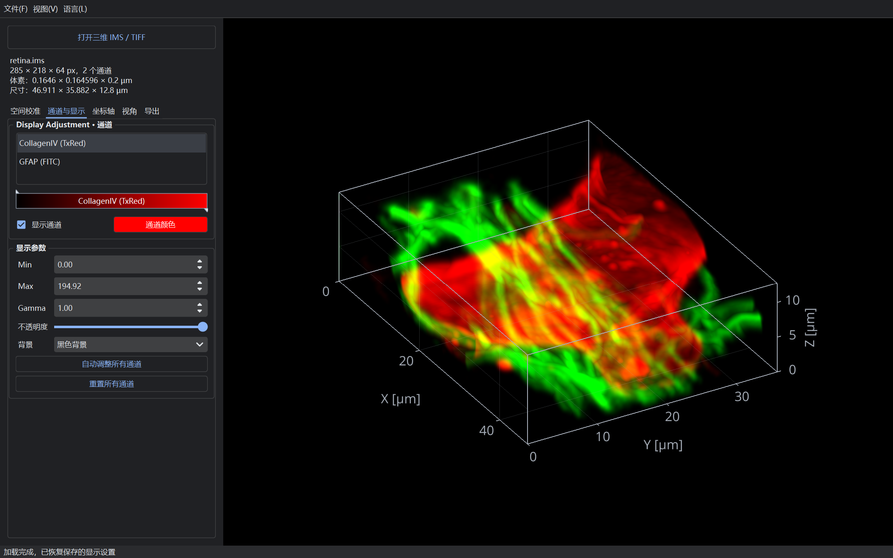
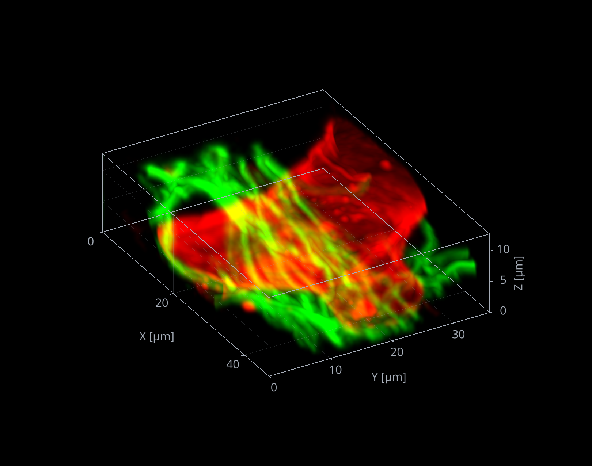
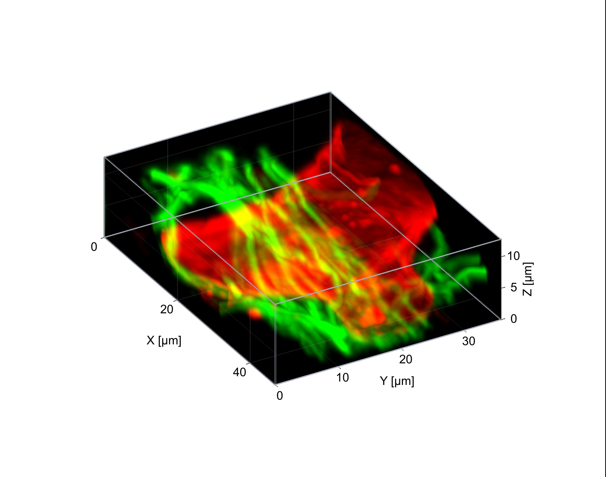

<p align="center">
  <a href="README.md">中文</a> |
  <a href="README.en.md">English</a>
</p>

<div align="center">
  

  # Tron 3D viewer

  **轻量级、开源的三维显微图像查看器**

  读取 IMS 与 TIFF 体数据，交互式调整通道和视角，导出适合论文排版的图像。

  [](https://www.python.org/)
  [](https://www.qt.io/qt-for-python)
  [](https://www.opengl.org/)
</div>

## 功能特性

- **三维体渲染**：以最大强度投影（MIP）显示 IMS 和多页 TIFF 图像，支持多通道叠加。
- **交互式视角**：自由旋转、平移和缩放，一键切换 XY、XZ、YZ 正交视图，也可精确设置旋转角度。
- **通道显示调整**：独立控制每个通道的颜色、可见性、对比度、Gamma 和不透明度，支持一键自动调整。
- **空间校准**：读取图像元数据中的体素尺寸，也可按体素大小或整体物理尺寸重新校准。
- **IMS 保存与恢复**：将图像、体素校准、视角、平移缩放、通道显示、Frame 和刻度间距保存在同一 IMS 文件中，再次打开自动恢复。
- **可定制坐标轴**：分别显示或隐藏边框、网格、刻度和标签，并记忆上次选择；网格默认关闭，支持自定义 X/Y/Z 刻度间距。
- **高质量导出**：导出 1×、2× 或 4× PNG，以及带矢量刻度与文字的 PDF，便于后续论文排版。
- **大图像预览**：根据数据规模自动降采样，交互时动态调整渲染质量，兼顾流畅度与静止画面质量。
- **简洁桌面界面**：基于 PySide6 的深色界面，实时显示图像尺寸、通道数、体素大小和物理尺寸。

## 界面与导出效果

以下示例使用 retina 数据，叠加显示 CollagenIV（红色）和 GFAP（绿色）通道。

**软件界面**：在“通道与显示”面板中选择通道并调整显示参数。



**PNG 导出效果**：保留黑色背景、三维边框和坐标轴。



**PDF 导出效果**：下图由实际导出的 PDF 渲染，Frame 外部透明，在白色页面上预览；原 PDF 中的边框、网格、刻度与文字均为矢量。



## 环境要求

- Python **3.11 或更高版本**
- 支持 **OpenGL 2.1 或更高版本**的显卡及驱动
- 推荐使用 [uv](https://docs.astral.sh/uv/) 管理环境和依赖

## 安装

### 使用 uv（推荐）

```bash
git clone https://github.com/Achuan-2/openimaris.git
cd openimaris
uv sync
```

### 使用 pip

在已有的 Python 3.11+ 环境中执行：

```bash
git clone https://github.com/Achuan-2/openimaris.git
cd openimaris
python -m pip install .
```

## 如何使用

### 启动应用

使用 uv：

```bash
uv run tron3d
```

使用 pip 安装后：

```bash
tron3d
```

也可以在启动时直接打开图像：

```bash
tron3d "path/to/image.ims"
tron3d "path/to/image.tif"
```

### 查看与调整图像

1. 将 IMS / TIFF 文件直接拖入窗口，或点击 **打开三维 IMS / TIFF**、使用 `Ctrl+O` 选择图像。
2. 在左侧 **通道与显示** 面板中选择通道，调整颜色、Min/Max、Gamma 和不透明度。
3. 使用 **空间校准** 和 **Frame · 坐标轴** 面板设置物理尺寸、坐标轴元素与刻度间距。
4. 通过鼠标或 **视角与旋转** 面板调整构图。

X/Y/Z 刻度间距以整数显示，微调按钮每次增加或减少 50 µm。

| 操作 | 效果 |
| --- | --- |
| 左键拖动 | 旋转三维视角 |
| 右键拖动 | 平移图像 |
| 鼠标滚轮 | 缩放图像 |

视图菜单还提供三维视角重置、XY/XZ/YZ 正交视图和 Z 轴翻转。

### 保存 IMS

使用 **文件 → 保存 IMS**（`Ctrl+S`）或 **保存与导出 → 保存 IMS（含显示设置）**。打开 TIFF 时会提示另存为 IMS；打开 IMS 时直接保存到当前文件，也可用 `Ctrl+Shift+S` 另存一份。

保存保留原始分辨率数据，不会用降采样预览替代原图；已有 IMS 的分辨率层级、时间点和其他对象会一并保留。体素校准写入 IMS 图像元数据，视角和 Frame 等显示设置由 Tron 3D viewer 在重开时恢复。

Box、Grid、Ticks、Labels 的显示开关优先沿用软件记住的上次选择，无需保存 IMS 即可记忆。

### 导出图像

- **PNG**：在 **保存与导出** 中选择 1×、2× 或 4× 倍率，然后点击 **导出 PNG**。
- **PDF**：点击 **导出 PDF（矢量文字）**，设置成图宽高、字体大小和渲染倍率。宽高包含完整的坐标文字，自动去除外围留白；修改任一尺寸或字号，另一尺寸会按当前视角联动，保持三维图像比例。三维体数据以图像嵌入，坐标轴刻度与文字保持矢量。
- 也可通过文件菜单导出；`Ctrl+Shift+E` 对应 PDF 导出。

> 调整参数和导出图像不会改写源文件；执行“保存 IMS”时才将设置写入 IMS。

## 支持的输入

- **Imaris IMS**：读取第一时间点的多通道三维数据，自动选择合适的分辨率层级。
- **TIFF**：支持三维堆栈、多通道数据及常见 ImageJ 体素尺寸元数据；时间序列默认读取第一时间点。

## 开发

安装开发环境并运行测试：

```bash
uv sync
uv run pytest
```
